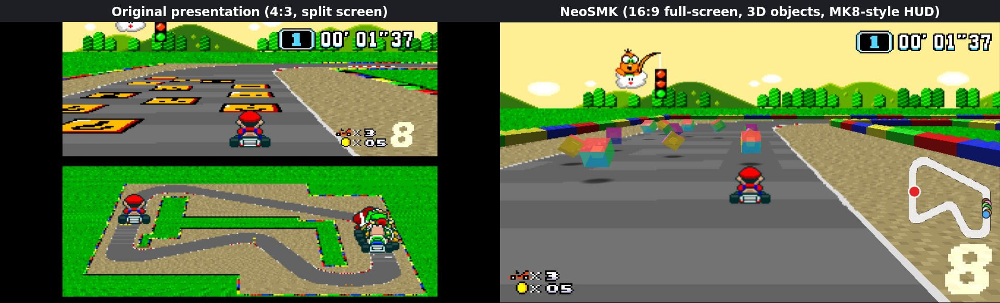
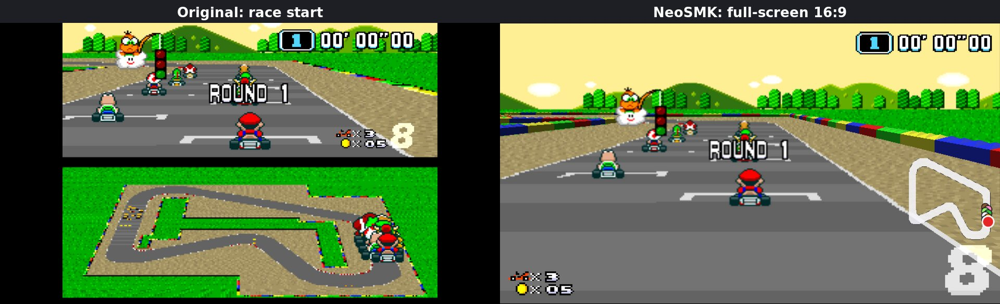
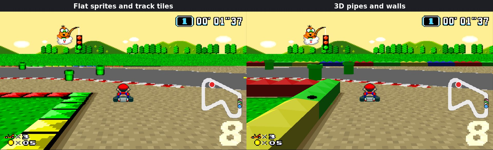
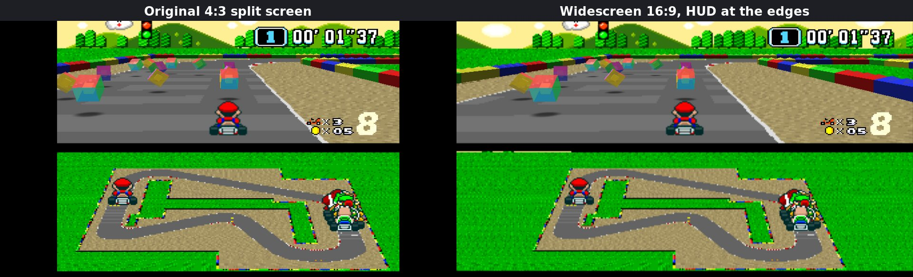
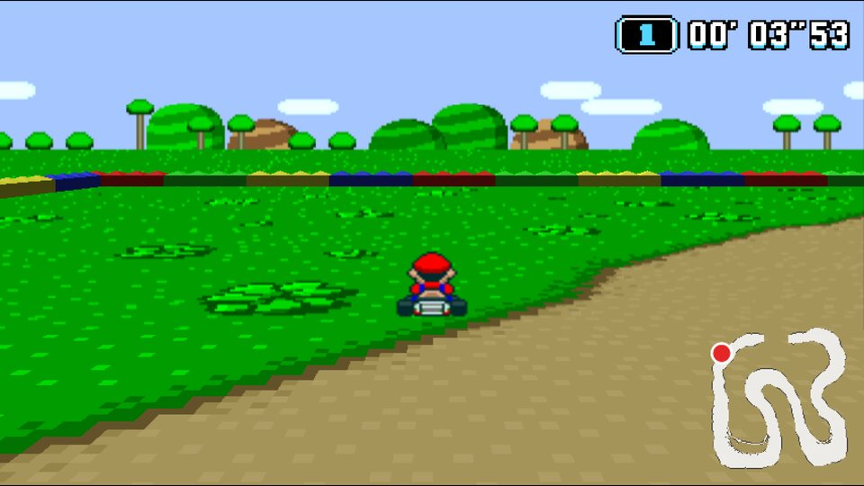
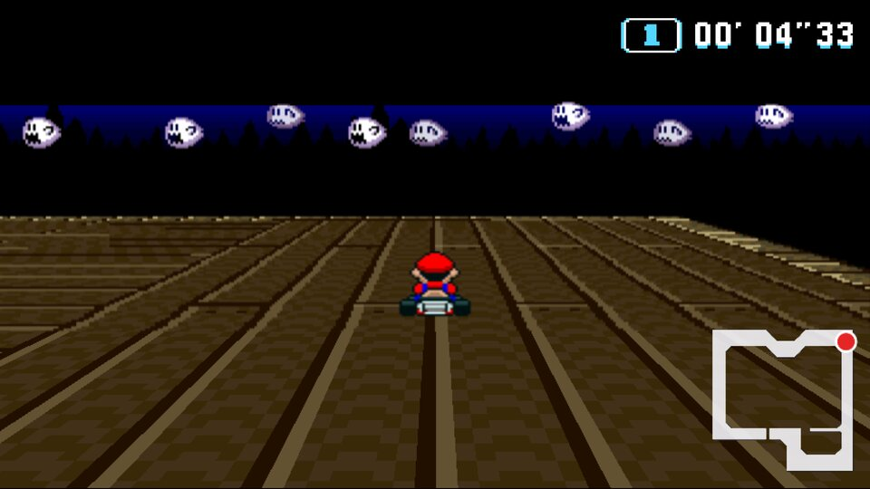
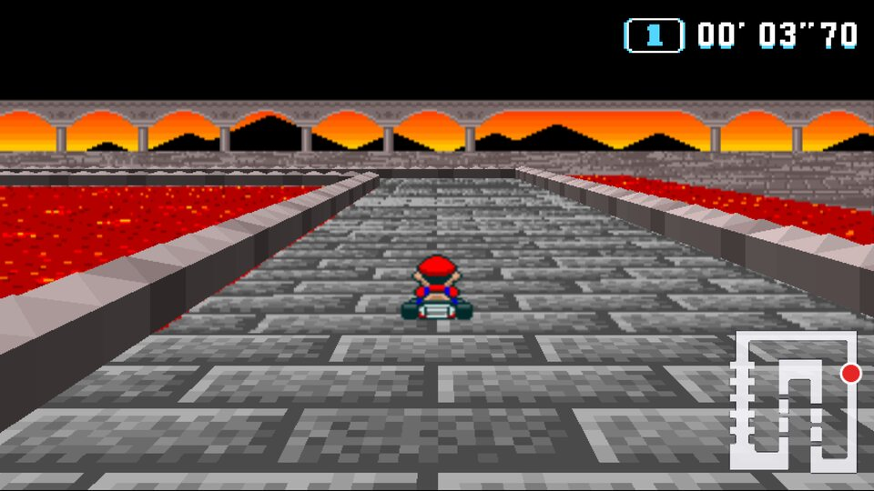

# NeoSMK

**Super Mario Kart** (SNES, 1992) as a native PC game: a static recompilation rebuilt on
SDL3 + OpenGL ES 3.0, with true **16:9 widescreen**, **full-screen single-player races**, real
**3D objects** on the track, a **Mario Kart 8-style HUD** and **Mario Kart 64 gameplay**
additions. Built for **Windows x64** (prebuilt), plus Linux x64 and Raspberry Pi 4 from source.



NeoSMK is a fork of [sp00nznet/mk](https://github.com/sp00nznet/mk) (65C816 → C recompilation
on the [LakeSnes](https://github.com/angelo-wf/LakeSnes)-based `snesrecomp` hardware backend).
The game's logic runs unmodified; everything NeoSMK adds sits on top of it and, apart from the
two gameplay options (MK64 mini-turbo and MK64 items), never changes the emulated game.

## Download (Windows)

Get **`neosmk-windows-x64.zip`** from [`releases/`](releases/README.md) (v0.7.0), unzip it, and
put your own Super Mario Kart ROM next to `neosmk.exe`. Nothing else needs installing.

**The ROM is not included.** Use your own **US v1.0** dump
(MD5 `7f25ce5a283d902694c52fb1152fa61a`), named `Super Mario Kart (USA).sfc`, or drag it onto
`neosmk.exe`.

## Screenshots

Each pair shows the same moment, without and with NeoSMK's additions.

**Full-screen single-player races.** The race fills the screen instead of the top half. The
track below the original view is drawn on the GPU, and the scenery and Lakitu are extended
above it. The overview map gives way to a circuit map and a Mario Kart 8-style HUD.



**3D objects.** Barrier blocks, warp pipes, coins and item boxes become real 3D objects with
shadows, depth-sorted against the karts.



**Widescreen.** The game renders extra columns on each side instead of stretching the picture,
and its own HUD moves out to the screen edges. This also works with the original split-screen
layout.



**Other tracks**, all in full-screen 16:9 with their own circuit map:

| Donut Plains 1 | Ghost Valley 1 | Bowser Castle 1 |
|---|---|---|
|  |  |  |

## Features

**Presentation** (all visual only, each can be switched off):

- **Widescreen 16:9 / 16:10.** The PPU renders up to 64 extra columns each side of the
  256-pixel line, so Mode 7 and the scenery extend for real, with no stretching. SMK's own HUD
  moves out to the screen edges.
- **Full-screen single-player races** (Graphics menu). The race fills the screen instead of the
  top half. The track below SMK's view is rendered on the GPU from the Mode-7 tilemap through a
  camera reconstructed from the game's own Mode-7 registers. The scenery and sprites above it
  are extended upward, so nothing is cut off. The split-screen overview map is replaced by:
- **Circuit map**, Mario Kart 8 style, with a dot per racer in its character's colour.
- **MK8-style HUD**: timer top-right, lives / coins bottom-left, a big position number
  bottom-right.
- **3D objects**: spinning item boxes, coins, barrier walls and warp pipes, with blob shadows,
  replacing the flat graphics. Karts and other sprites are depth-sorted against them.
- **Renderer**: 640×480-class internal target with depth, optional FXAA, sharp-bilinear
  upscaling to 480p / 720p / 1080p, optional scanlines.

**Gameplay** (options in the NeoSMK menu, shared with netplay peers):

- **MK64 mini-turbo.** Power-slide (hop with R while steering), then flick the D-pad toward the
  *outside* of the turn: one flick gives yellow sparks, three give orange. Release R on orange
  for a boost.
- **MK64 items.** Item boxes can also give a triple mushroom, a golden mushroom (boost as often
  as you like for 7.5 s), triple green or red shells, or a banana bunch. Dots under the item
  box show the uses left. Player 1 only for now.

**Custom race music** (Sound menu):

- Put your own `.mp3` files in the `music/` folder next to `neosmk` and turn on **Sound →
  Custom race music**. A different song plays each race while the course music would, and the
  game's sound effects (engines, items, Lakitu) stay. The countdown and finish music are the
  game's own. **Race music volume** sets the level. The folder is read again at every race, so
  songs can be added while the game runs.
- Under the hood, SMK's sound driver keeps a mask of the voices that are playing sound effects
  (sound RAM `$1A`), and its course-music slot (`$04` = 4). NeoSMK leaves the other voices out
  of the audio output with a second, presentation-only mix inside the sound chip, so the
  emulated sound chip and its echo memory are untouched: replays, save states and netplay are
  unaffected.

**Platform:**

- Fixed 60.0988 Hz game logic (one NTSC SNES frame per tick) with an independent renderer;
  vsync-snapped ticks give judder-free 60 FPS, and an audio rate controller prevents crackles.
- OpenGL ES 3.0 with a desktop GL 3.3 core fallback; static SDL 3.2; keyboard and Xbox-style
  gamepads for both players, all rebindable.
- **Netplay**: lockstep 2-player over TCP with a desync check (see below).
- Save states (F5 / F8).

## Controls

Command line:

```
neosmk [--480p|--720p|--1080p] [--windowed|--fullscreen|--borderless] [rom.sfc]
```

| Key | |
|---|---|
| Arrows | D-pad |
| Z / X / A / S | B / Y / A / X |
| Q / W | L / R |
| Enter / Right Shift | Start / Select |
| F1 (or gamepad Guide) | show / hide the menu bar |
| F5 / F8 | save / load state |
| F11, Alt+Enter | toggle borderless fullscreen |
| Esc | quit |

Xbox-style gamepads work out of the box for both players (SDL3 gamepad database). Everything
is rebindable under **Controller**. The **Graphics** menu has output resolution, display mode,
aspect ratio (4:3 / 16:10 / 16:9, and whether menus are widened too), V-Sync, upscale filter,
FXAA, scanlines and an FPS overlay. Settings save to `smk_config.ini`.

### Netplay

Lockstep netplay over TCP: the host is Player 1, the client Player 2.
One player opens **Multiplayer → Host** (port 7878 by default; forward it on the router for
internet play), the other enters the host's IP and picks **Join**. On connect, the host's game
state and gameplay options (MK64 mini-turbo and items) are copied to the client. From then on both
machines run the same game in sync; choose **2P GAME** in the game's menu. Both players need
the same NeoSMK version and ROM. Graphics and other visual options can differ between them.

- **Input delay** (host sets it, 2–3 frames for LAN, more over the internet) gives the network
  slack before a frame has to wait for the other player.
- **Sync check:** every 30 frames the peers compare a checksum of the game state; if they ever
  differ, the Multiplayer window says the games are out of sync (reconnect to resync).
- **Disabled while connected:** File → New and Load (F8), which would put the two games out of
  sync. Save still works.

**Debug → 3D camera markers** floats a 3D marker over every racer, to check the camera that
NeoSMK reconstructs from Mode 7.

## Targets

| | |
|---|---|
| Platforms | **Windows 10/11 x64** (prebuilt), Linux x64, Raspberry Pi 4 (from source) |
| Minimum hardware | Raspberry Pi 4, 2 GB |
| Rendering API | OpenGL ES 3.0 (desktop OpenGL 3.3 core fallback) |
| Internal resolution | 640×480 (4:3) · 856×480 (16:9) · 770×480 (16:10) |
| Performance | locked 60 FPS on a 60 Hz display (16.67 ms frame budget) |
| Output | 480p / 720p / 1080p, windowed, exclusive fullscreen or borderless |
| RAM | ~15 MB resident for emulation |

## Building from source

CMake ≥ 3.20 and a C17/C++17 compiler are required. SDL 3.2.30 is downloaded and built
statically at configure time (`-DNEOSMK_SYSTEM_SDL3=ON` uses an installed SDL3 instead;
`-DNEOSMK_SDL3_SOURCE=<dir|tarball>` builds offline).

### Windows x64

Visual Studio 2022 (MSVC), no package manager needed:

```sh
cmake -B build -G "Visual Studio 17 2022" -A x64
cmake --build build --config Release
build\Release\neosmk.exe
```

The exe is self-contained (static SDL and CRT). The release package is cross-built from Linux
with MinGW-w64: `-DCMAKE_TOOLCHAIN_FILE=cmake/toolchains/mingw-w64-x86_64.cmake`.

### Linux x64 / Raspberry Pi 4 (native)

```sh
sudo scripts/install-deps-debian.sh            # Debian, Ubuntu, Raspberry Pi OS
cmake -B build -G Ninja -DCMAKE_BUILD_TYPE=Release
# on the Pi add: -DNEOSMK_TUNE_PI4=ON  (Cortex-A72 code generation)
cmake --build build
./build/neosmk "Super Mario Kart (USA).sfc"
```

### Raspberry Pi 4 (cross-compile from x86-64 Debian Bookworm)

```sh
sudo scripts/install-deps-debian.sh arm64
cmake -B build-pi4 -G Ninja -DCMAKE_BUILD_TYPE=Release \
      -DCMAKE_TOOLCHAIN_FILE=cmake/toolchains/aarch64-linux-gnu.cmake -DNEOSMK_TUNE_PI4=ON
cmake --build build-pi4
```

Built against Bookworm's glibc, the binary runs on 64-bit Raspberry Pi OS Bookworm and newer.

### CI

`.github/workflows/build.yml` builds all three targets on every push and smoke-tests each
binary (the ARM64 one under qemu). Pushing a `v*` tag publishes a release with
`neosmk-linux-x64.tar.gz`, `neosmk-linux-arm64-pi4.tar.gz` and `neosmk-windows-x64.zip`.

## Running on a Raspberry Pi 4

- **Desktop (X11/Wayland):** run as normal; `--borderless` for fullscreen.
- **Console / no desktop (best performance):** `SDL_VIDEO_DRIVER=kmsdrm ./neosmk --fullscreen --720p`
  drives the display directly through KMS/DRM. `--fullscreen` switches the display to the chosen
  preset, which also suits 4K TVs.
- Use the 64-bit OS with the default `vc4-kms-v3d` overlay. The V3D driver provides
  OpenGL ES 3.1.
- `SMK_STATS=1` prints the present rate, logic rate and frame time every 2 s. See
  [Performance](#performance).

## Environment variables (testing and automation)

| Variable | Effect |
|---|---|
| `SMK_GL=es` / `gl` | force OpenGL ES 3.0 or desktop GL 3.3 core |
| `SMK_FAST=1` | unthrottled (no pacing, no vsync), for benchmarks / automation |
| `SMK_HEADLESS=1` | hidden window, no menu; runs without a GPU if none is available |
| `SMK_STATS=1` | log fps / logic rate / frame time every 120 frames |
| `SMK_SCRIPT=…`, `SMK_MAX_FRAMES=N` | scripted input (`frame:BTN`, `a-b:BTN`) and auto-exit |
| `SMK_SNAPSHOT_PREFIX`, `SMK_SNAPSHOT_EVERY` | WRAM/VRAM/CGRAM snapshots for diffing |
| `SMK_MP_HOST=port`, `SMK_MP_JOIN=ip:port`, `SMK_MP_DELAY`, `SMK_MP_WAIT=1`, `SMK_MP_LOG=1` | netplay without the menu: host / join, input delay, host waits for the peer before running frames, log state checksums every 60 frames |
| `SMK_SHOT_AT="frame:file.bmp,…"` | screenshot the frame presented after logic frame N |
| `SMK_POKE16="frame:addr:value,…"` | write a WRAM word (hex) after logic frame N, for test setups like a cheat code |
| `SMK_ITEM_ROLL=0..99`, `SMK_ITEM_TRIPLE_ANY=1` | MK64 items testing: fixed variant roll, or every item comes as a triple |
| `SMK_AUDIO_DUMP=<file.wav>` | write the audio output (after custom music) to a WAV file |
| `SMK_DUMP_M7=<prefix>` | per-scanline Mode-7 state every 60 frames (camera debugging) |
| `SMK_SHELLS=1`, `SMK_RECOMP=1`, … | upstream recompilation development modes (see `docs/`) |

Example: boot to a race and benchmark the emulation with no GPU work:

```sh
SDL_VIDEO_DRIVER=dummy SMK_HEADLESS=1 SMK_FAST=1 SMK_MAX_FRAMES=2400 \
SMK_SCRIPT="420:START,421:Y,600:START,660:START,720:START,780:START,840:START,900:START,960:START,1020:START,1080:START,1140:START,1200:START,1260:START,1320:START,1380:START,1440:START,1500:START,1550-2400:B" \
./neosmk
```

## Performance

On a 2.1 GHz Xeon core, emulation costs **3.5 ms per frame** at 4:3 and **4.0 ms** in 16:9
races, with ~15 MB resident. Under the CPU-only llvmpipe rasterizer at 1080p the game holds
60 FPS.

The Raspberry Pi 4 hasn't been measured on hardware yet. A Cortex-A72 is roughly 3–4× slower
per core, which puts emulation at an estimated 11–16 ms of the 16.67 ms budget. Profiling shows
the PPU's per-pixel compositor is about half the cost and the 65C816 core about a fifth. If the
Pi misses 60, the plan is a per-scanline PPU fast path and/or moving emulation off the render
thread (the Pi has 4 cores). Please run `SMK_STATS=1` on a Pi and report the numbers.

## Known limitations

- **Widescreen edges:** the game only spawns and animates objects inside its 256-pixel view, so
  karts and items can appear or disappear at the extended edges. The 1–2 black lines the game
  draws across the top of the 4:3 picture don't extend into the sides.
- **Windows:** without a driver ES extension or ANGLE, SDL can't create an ES context and NeoSMK
  uses desktop GL 3.3 (same renderer, same output).

## Project structure

```
├── src/main/main.c           entry point, CLI, fixed-timestep loop, test hooks
├── src/neo/                  NeoSMK layer: 3D objects, HUD, circuit map, MK64 gameplay
├── src/recomp/               recompiled game functions (upstream)
├── include/smk/              smk_XXXXXX declarations
├── ext/snesrecomp/           SNES backend library
│   ├── src/platform_sdl3.c   SDL3 window / GL context / audio / scheduler
│   ├── src/gfx/              GL ES loader, renderer, 3D layer (scene3d)
│   ├── src/m7view.c          camera reconstruction from Mode 7
│   ├── src/mp_session.c      lockstep netplay
│   ├── src/menu_overlay.cpp  ImGui menu
│   ├── ext/LakeSnes/snes/    hardware emulation (PPU with the presentation extensions)
│   └── third_party/imgui/    Dear ImGui 1.91.9b
├── cmake/                    SDL3 dependency, cross toolchains
├── docs/                     roadmap, RAM map, reverse-engineering notes, screenshots
├── releases/                 Windows builds
└── tools/                    reverse-engineering and recompilation tooling
```

## Credits and license

MIT. Built on [sp00nznet/mk](https://github.com/sp00nznet/mk), snesrecomp and LakeSnes (MIT),
Dear ImGui (MIT) and SDL (zlib); see [`THIRD_PARTY_LICENSES.md`](THIRD_PARTY_LICENSES.md).
NeoSMK is a fan project, not affiliated with or endorsed by Nintendo. No ROM or game assets are
included; you need your own legally obtained copy of the game. Super Mario Kart is a trademark
of Nintendo.
